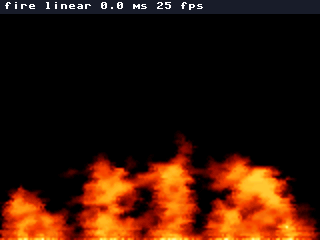
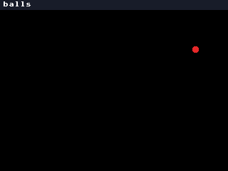
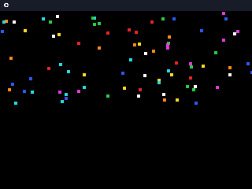

# pixel-engine

A small game engine in C for MicroPython on the ESP32-S3. Python decides what happens, and C does the work per body
and per pixel: it steps the bodies, collides the balls, burns and blends the fire, and reports hits as events.
[pixel-games](https://github.com/xmejkal/pixel-games) builds its firmware with this engine and plays its games on it.

## What is here

| path | what it holds |
| --- | --- |
| `core/` | plain C with no MicroPython in it: `world.c` (bodies that fall and land), `fx_balls.c` and `grid.c` (balls that collide), `fx_fire.c` (the heat field), `events.h` (hits and sleeps) |
| `binding.c` | the MicroPython module `engine`: `Bodies`, `Balls` and `HeatField` over the core |
| `micropython.cmake` | the user C module that a MicroPython build includes |
| `driver/` | a git submodule: the [s3lcd fork](https://github.com/xmejkal/s3lcd). The binding draws into its frame, and `fx_fire.c` uses its `blend565.h` |
| `tests/` | the Mac tests of the core: clang builds it, and ctypes calls it |

## What it looks like

pixel-games draws the three layers on a Mac with this repository's C and a stand-in for the display. Its `tools/render_scene.py --all docs/screenshots` wrote these frames at pixel-games commit eea160f5. They are renders, not photos of the board.



`fx_fire.c`, the heat field: it burns over the whole 320 x 240 screen, under the label that names the mode and the frame rate.



`fx_balls.c` and `grid.c`, the balls: a pour of ten balls every 0.4 s falls, knocks, bounces and piles up in layers of colour.



`world.c`, the bodies: 160 boxes fall, bounce and come to rest near the bottom, each on its own line, and a sleeper falls again from the top.

The history before this repository lives in pixel-games. A PR number in a commit message (for example `#16`) is a
pixel-games PR.

## Get it and test it

```sh
git clone --recurse-submodules https://github.com/xmejkal/pixel-engine.git
cd pixel-engine
python3 -B -m unittest discover tests
```

The tests need clang. Without it, they skip.

## Build it into the firmware

A MicroPython build takes this folder's `micropython.cmake` and the driver's `driver/src/micropython.cmake` as user C
modules. pixel-games mounts this repository at `engine/`, and its `build.sh engine` does the build.
